  

  

  
  
  
  

## 🌍 About

PhD candidate, Earth & Atmospheric Sciences, [NIT Rourkela](https://www.nitrkl.ac.in/) (defence expected December 2026).

**Focus:** machine learning for weather, climate, and wildfire; atmosphere–biosphere fluxes; remote sensing; graph neural networks and transformers; quantum machine learning.

  
  

## 🔥 Featured projects

| Repository | Description |
|---|---|
| [climate-kernel-emulator](https://github.com/murushyam/climate-kernel-emulator) | Interpretable nonlocal-kernel climate emulator following the ClimateBench protocol |
| [wildfire-flux-explorer](https://github.com/murushyam/wildfire-flux-explorer) | Interactive explorer for wildfire–flux relationships ([live demo](https://murushyam.github.io/wildfire-flux-explorer/)) |
| [acid-fts](https://github.com/murushyam/acid-fts) | Causal-informed fuzzy time series for fire-weather forecasting |
| [india-forest-soc-fire](https://github.com/murushyam/india-forest-soc-fire) | Soil organic carbon and wildfire in Indian forests (pre-release) |
| [IFM_Forecasting_Herault](https://github.com/murushyam/IFM_Forecasting_Herault) | Fire Weather Index (FWI) forecasting |
| [qcnn_change_detection](https://github.com/murushyam/qcnn_change_detection) | Quantum CNN for burned-area change detection (fork; contributed / adapted) |

## 🛰️ Tools & data

  

Python · PyTorch · PyTorch Geometric · Xarray · GDAL · ERA5 · MODIS · Sentinel-2 · WRF-Chem · Qiskit

## 🔗 Links

- Website: [murushyam.github.io](https://murushyam.github.io/)
- Google Scholar: [citations](https://scholar.google.com/citations?user=O2puAlYAAAAJ&hl=en)
- ORCID: [0000-0002-9964-6199](https://orcid.org/0000-0002-9964-6199)
- LinkedIn: [shyam-sunder-ms](https://www.linkedin.com/in/shyam-sunder-ms-797423a9/)
